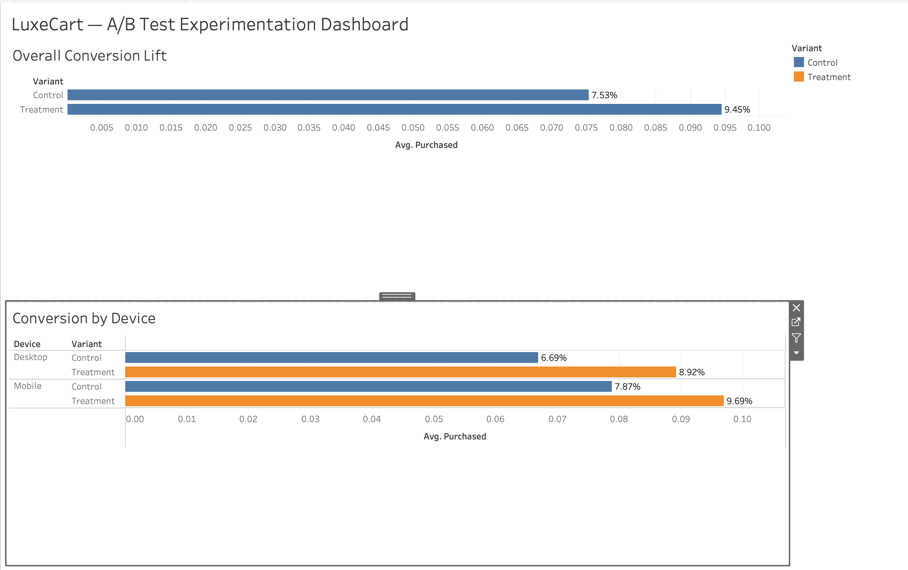

# 🛍️ LuxeCart: A/B Testing & Conversion Rate Optimization (CRO) Engine

**Background:** BSc. CSIT | Lalitpur, Nepal  
**Focus:** Product Analytics, Hypothesis Testing & Experimentation  
**Tech Stack:** Python (Pandas, Statsmodels), Microsoft Excel, Tableau Public  

---

## 📌 Executive Summary
LuxeCart is a premium cosmetics e-commerce brand experiencing steady traffic (~100,000 monthly visitors), but with a checkout completion rate plateaued at **7.53%**. The product team engineered a new **"1-Click AI Checkout"** feature designed to eliminate checkout friction on mobile devices.

As the Product Data Analyst, I acted as the statistical referee: running a 20,000-user A/B experiment, verifying statistical significance, evaluating device-level interaction effects, and modeling the commercial revenue upside.

### 🔑 Key Strategic Discoveries:
1. **Statistically Significant Conversion Lift:** The 1-Click AI Checkout (Treatment) lifted conversion from **7.53% to 9.45%**—a **+25.50% relative lift**.
2. **Definite Statistical Significance ($p < 0.0001$):** A 2-Sample Proportions Z-Test yielded $z = 4.88$ and **$p = 0.00000$**, proving less than a 1-in-a-million probability of random chance.
3. **Cross-Device Growth:** 
   * **Mobile:** Lifted from 7.87% to 9.69% (+23.1% relative lift), capturing the bulk of enterprise volume.
   * **Desktop:** Lifted from 6.69% to 8.92% (+33.3% relative lift).
4. **Commercial Impact:** At baseline traffic (100k monthly visitors, $65 AOV), rolling out this feature generates **+$124,800 in incremental monthly revenue**, translating to **+$1,497,600 in annualized top-line growth**.

---

## 🔬 Statistical Experimentation Pipeline (Python)

The experiment evaluated 20,000 randomized users (10,000 Control vs. 10,000 Treatment) using a **2-Sample Proportions Z-Test** (`statsmodels`):

```python
from statsmodels.stats.proportion import proportions_ztest

# 1. Summary Metrics
conversions = [summary.loc['Treatment', 'total_buyers'], summary.loc['Control', 'total_buyers']]
total_users = [summary.loc['Treatment', 'total_visitors'], summary.loc['Control', 'total_visitors']]

# 2. Hypothesis Testing (Alpha = 0.05)
z_stat, p_val = proportions_ztest(count=conversions, nobs=total_users, alternative='larger')

# Result: p-value = 0.00000 < 0.05 -> Statistically Significant (Ship to 100%)

```
📈 Commercial ROI & Revenue Model (Excel)

An interactive financial model built to forecast annualized revenue lift based on experimental results:

    Baseline Assumptions: 100,000 monthly visitors | $65.00 Average Order Value (AOV)

    Baseline Revenue (7.53% CVR): 7,530 orders/mo ×65=489,450 / month

    Projected Revenue (9.45% CVR): 9,450 orders/mo ×65= 614,250 / month

    Incremental Monthly Gain: +$124,800 / month

    Annualized Revenue Lift: 124,800×12=+1,497,600 / year

🎯 Executive Product Recommendations

    Authorize 100% Rollout: Immediately deploy the 1-Click AI Checkout across 100% of production traffic based on verified statistical significance.

    Double Down on Mobile UX: Mobile generated the highest absolute conversion rate (9.69%). Continue optimizing mobile-first payment integrations  (Apple Pay, Google Pay).

    Monitor Guardrail Metrics: Maintain continuous tracking on Average Order Value (AOV) and return rates to ensure 1-click ease does not inflate impulse cancellations.

## 📊 Interactive Tableau Dashboard
Explore the live, interactive executive dashboard here:  
**[Click here to view on Tableau Public](https://public.tableau.com/app/profile/bliss.bliss/viz/LuxeCartABTestingDashboard/LuxeCartABTestExperimentationDashboard?publish=yes)**


